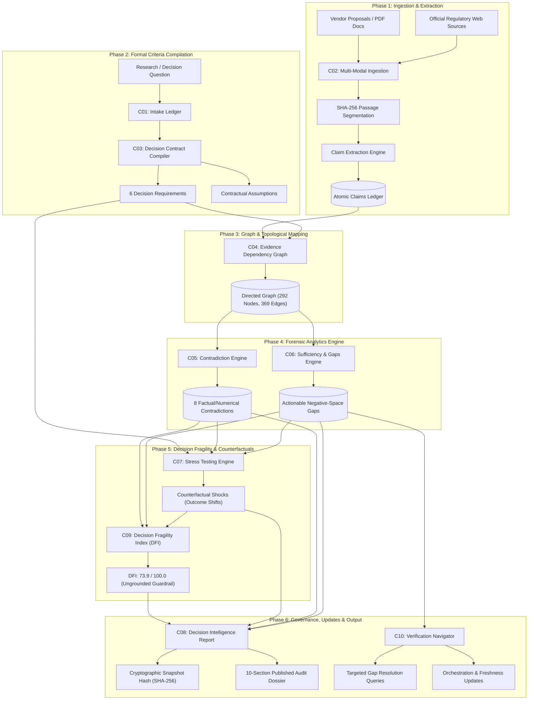

# TRUTHMAP AI — System Architecture & Design Specification

## 1. Architectural Philosophy: The Epistemic Boundary

Traditional AI decision-support tools summarize available documents, accepting assertions at face value. **TRUTHMAP AI** operates under an evidence-first, forensic intelligence paradigm designed to answer four critical questions:
1. **What is explicitly claimed vs. independently verified?**
2. **What critical evidentiary requirements are completely missing?**
3. **Where do claims contradict regulatory, legal, or physical reality?**
4. **How fragile is the decision if unverified assumptions fail under stress?**

```
┌────────────────────────────────────────────────────────────────────────┐
│                        TRUTHMAP AI CORE PRINCIPLE                      │
│   "Traditional AI tools summarize available information.               │
│    TRUTHMAP AI investigates what is missing, conflicting,              │
│    outdated, and still needs verification."                            │
└────────────────────────────────────────────────────────────────────────┘
```

---

## 2. High-Level System Architecture Diagram



---

## 3. Epistemic Pipeline Layers (C01–C10)

### Layer 1: Ingestion & Evidentiary Provenance (C01, C02)
- **C01 (Investigation Intake):** Normalizes the core hypothesis, assigns immutable UUIDs, and registers audit-trail records.
- **C02 (Multi-Modal Ingestion):**
  - **PDF Extraction:** Implemented using PyMuPDF (`fitz`), generating page-accurate, character-indexed text spans.
  - **Web Scraping:** Trafilatura extraction with strict SSRF defense (blocking RFC 1918 private ranges, loopbacks, and cloud metadata endpoints `169.254.169.254`).
  - **Cryptographic Provenance:** Every passage is sealed with a deterministic SHA-256 hash. Claims link back to exact passage IDs.

### Layer 2: Decision Contract Compilation (C03)
- Deconstructs an ambiguous research question into formal, testable operational criteria:
  1. Statutory & Eligibility Boundaries
  2. Cohort Demographics & Sizing
  3. Direct Benefit Uptake & Service Delivery
  4. Counterfactual Baseline & Control Comparison
  5. Causal Impact vs. Confounding Influences
  6. Operational Friction, Attrition & Displacement

### Layer 3: Knowledge Graph Topology (C04)
- Implements a multi-tiered topological bipartite directed graph:
  - **Tier 1:** Contract Objective
  - **Tier 2:** Requirements & Constraints
  - **Tier 3:** Evidence Requirements (Artifact specifications)
  - **Tier 4:** Atomic Extracted Claims
  - **Tier 5:** Provenance Passages (SHA-256)
  - **Tier 6:** Ingested Source Documents

### Layer 4: Forensic Analytics & Negative-Space Detection (C05, C06)
- **C05 (Contradiction Engine):** Cross-analyzes claims across documents using deterministic numerical matching and semantic validation. Identifies:
  - Numerical value disparities on identical metrics (e.g. ₹2.08 export credit vs. ₹9.60 tariff).
  - Scope/cohort mismatches (e.g. Residential 3 kW subsidy claimed for a 100 kW industrial facility).
- **C06 (Sufficiency & Gap Analysis):** Evaluates requirement coverage against 5 states (`SUFFICIENT`, `PARTIAL`, `INSUFFICIENT`, `CONFLICTING`, `NO_EVIDENCE`). Uncovers *negative-space gaps* (what *should* exist but is missing).

### Layer 5: Counterfactual Stress Testing & Fragility Index (C07, C09)
- **C07 (Decision Stress Testing):** Evaluates 5 categories of counterfactual shocks:
  - *Risk Materialization*
  - *Evidence Weakening*
  - *Missing Evidence Discovery*
  - *Adverse Conflict Resolution*
  - *External Condition Shifts*
- **C09 (Decision Fragility Index - DFI):** Deterministic 0–100 risk formulation computed across 5 weighted dimensions:
  $$DFI = 0.30 \cdot D_1 + 0.15 \cdot D_2 + 0.25 \cdot D_3 + 0.20 \cdot D_4 + 0.10 \cdot D_5$$
  - $D_1$: Requirement Coverage Deficit (weighted by priority: Critical=3, High=2, Medium=1).
  - $D_2$: Unvalidated Assumption Exposure.
  - $D_3$: Contradiction & Conflict Severity.
  - $D_4$: Stress Test Outcome Degradation.
  - $D_5$: Source Concentration (Herfindahl-Hirschman Index).
  - **Deterministic Safety Guardrails:** If any CRITICAL requirement is `NO_EVIDENCE` or `CONFLICTING`, the *Critical Deficit Guardrail* trips, preventing an unwarranted approval rating.

### Layer 6: Synthesis, Freshness & Verification (C08, C10)
- **C08 (Decision Intelligence Report):** Generates a structured 10-section audit brief. Supports instant (<0.1s) deterministic generation with cryptographic SHA-256 state seal.
- **C10 (Verification Navigator):** Formulates targeted research queries to close top-priority evidentiary voids, with honest reporting on external search provider availability.

---

## 4. Technology Stack & Component Allocation

| Domain | Technology | Purpose |
|---|---|---|
| **Frontend Framework** | React 18 + Vite | High-performance SPA with client-side routing |
| **Styling & Design** | Tailwind CSS + Lucide React | Clean, responsive cybersecurity/audit intelligence aesthetic |
| **Backend Framework** | FastAPI (Python 3.11 / 3.14) | Asynchronous, OpenAPI-documented REST service |
| **Application Server** | Uvicorn (ASGI) | Production-ready HTTP/WebSocket engine |
| **Database** | SQLite3 (WAL Mode) | Zero-configuration, ACID-compliant local forensic ledger |
| **PDF Extraction** | PyMuPDF (`fitz`) | High-fidelity local PDF text & table segmentation |
| **Web Scraping** | Trafilatura + BeautifulSoup4 | Structured article extraction with strict SSRF defense |
| **Generative AI** | Google GenAI SDK | Analytical report structuring and scenario formulation |
| **Test Harness** | Pytest + Pytest-Asyncio | 159 automated unit, integration, and regression tests |
