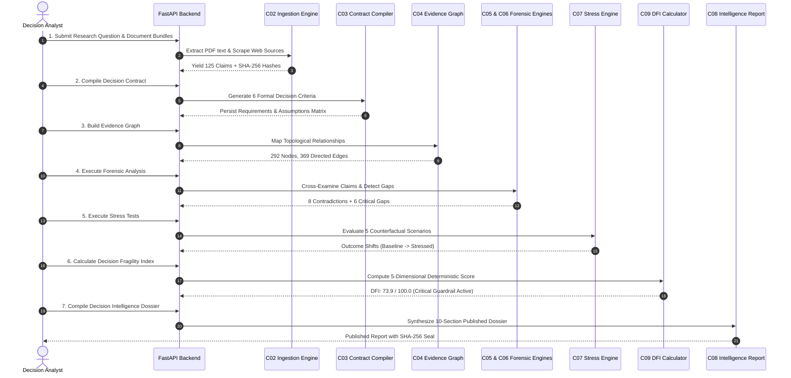

# TRUTHMAP AI — End-to-End System Workflow

This document details the data lifecycle, analytical state transitions, and audit-trail guarantees implemented across TRUTHMAP AI.

---

## 1. End-to-End Sequential Workflow Diagram



---

## 2. Forensic Epistemic Lifecycle States

Every piece of data in TRUTHMAP AI transitions through strict epistemic classification boundaries:

```
[Raw Proposal Claim] ──(Ingestion)──> [Unverified Claim Assertion]
                                             │
                       ┌─────────────────────┴─────────────────────┐
                       ▼                                           ▼
             [Statutory Conflict]                          [Supported Evidence]
         (Cross-Examined vs. Policy)                    (Corroborated by Primary Sources)
                       │                                           │
                       └─────────────────────┬─────────────────────┘
                                             ▼
                                 [Requirement Sufficiency]
                       (SUFFICIENT | PARTIAL | INSUFFICIENT | CONFLICTING)
                                             │
                                             ▼
                               [Stress Testing & Fragility]
                                (Counterfactual Degradation)
                                             │
                                             ▼
                                [Executive Decision Dossier]
                              (Cryptographically Sealed v1..vn)
```

---

## 3. Freshness & Invalidation Mechanism

When new evidence is ingested or an existing conflict is resolved:
1. **Cryptographic State Fingerprint:** The engine computes a unified SHA-256 digest across all active claims, contract requirements, conflicts, and sufficiency assessments.
2. **Staleness Flagging:** Any previously compiled report whose stored snapshot hash differs from the current investigation fingerprint is flagged with `is_stale: true`.
3. **Audit Trail Preservation:** Historical versions are never overwritten; recompilation increments the atomic `report_version` (e.g. `v1 -> v2 -> v3`), preserving complete evidentiary lineage.
